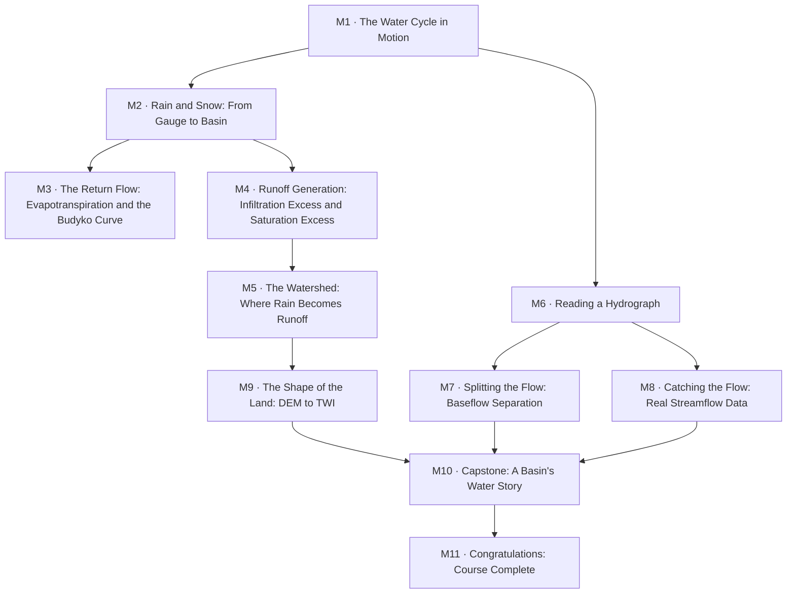

# Introduction to Hydrology

**11 modules · ~7 hours (420 min of lessons) · Intro level · CC-BY-4.0**  
**Author:** Mohammad Galib, Purdue University

A hands-on, animated tour through the whole hydrologic cycle — from the first flash of water vapour rising off the ocean, through precipitation, evapotranspiration and runoff generation, to a full basin characterisation at your fingertips. Ten learning modules, each showcasing a different interactive capability of the AI-Hydro learning hub, followed by a personalised certificate of completion.

## Module sequence

| # | Module | Time | Prerequisites |
|---|--------|------|---------------|
| 1 | [The Water Cycle in Motion](../../modules/water-cycle-in-motion/) | 30 min | none |
| 2 | [Rain and Snow: From Gauge to Basin](../../modules/precipitation-point-to-basin/) | 35 min | M1 |
| 3 | [The Return Flow: Evapotranspiration and the Budyko Curve](../../modules/evapotranspiration-budyko/) | 40 min | M2 |
| 4 | [Runoff Generation: Infiltration Excess and Saturation Excess](../../modules/runoff-generation/) | 40 min | M2 |
| 5 | [The Watershed: Where Rain Becomes Runoff](../../modules/watershed-runoff/) | 40 min | M4 |
| 6 | [Reading a Hydrograph](../../modules/reading-a-hydrograph/) | 30 min | M1 |
| 7 | [Splitting the Flow: Baseflow Separation](../../modules/baseflow-separation/) | 40 min | M6 |
| 8 | [Catching the Flow: Real Streamflow Data](../../modules/real-streamflow-data/) | 45 min | M6 |
| 9 | [The Shape of the Land: DEM to TWI](../../modules/dem-to-twi/) | 55 min | M5 |
| 10 | [Capstone: A Basin's Water Story](../../modules/capstone-basin-story/) | 60 min | M7, M8, M9 |
| 11 | [Congratulations: Course Complete](../../modules/course-certificate/) | 5 min | M10 |

## Prerequisite graph

Generated from the `prerequisites` of each module in `course.json`; an arrow means "comes before".



## Loading the course in AI-Hydro

Open the HTML Preview panel → Courses → paste the `course.json` URL:

```
https://raw.githubusercontent.com/AI-Hydro/Modules/main/courses/intro-to-hydrology/course.json
```

## License

[CC-BY-4.0](https://creativecommons.org/licenses/by/4.0/)
